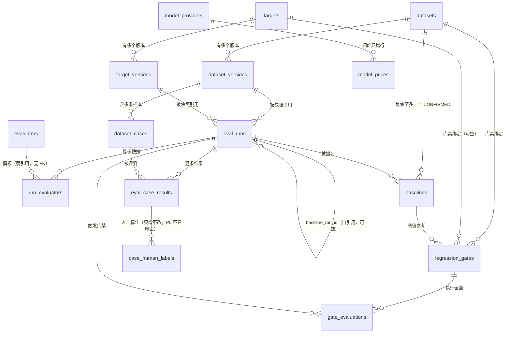

# 数据库表结构

> **本文件是「表结构 / 索引 / 外键级联 / 不可变触发器 / 迁移顺序」的唯一事实源。**
> 算子的评分与成本口径见 [`technical-solution.md`](./technical-solution.md) §2；
> 实体语义见 [`product-overview.md`](./product-overview.md) §6（`ED-01`…`ED-08`）。
> 规则依据：`docs/工程规则.md` 第 1 节「单一事实源原则」。
>
> 建立日期：2026-11-07 · 状态：**已确认**
> **表数量：13 张业务表 + 1 张门禁执行留痕表 + 1 张人工标注留痕表 = 15 张。**
> （需求方口头为「13 张」，因 `targets` / `target_versions` 原为一组、展开后实为 14 张；
> 加上 2026-11-07 拍板新增的 `case_human_labels`（`OUT-5` 的物理落点），合计 **15 张**。以本文件为准。）
>
> **需求方「7 张表」提案 → 本设计 14 张的展开原因**（不是加戏，是被不可变性逼出来的）：
>
> | 需求方 1 张 | 本设计 | 拆开的原因 |
> |---|---|---|
> | `datasets` + `dataset_versions` | 2 张 | 版本必须不可变（`PT-2`），容器可改名。同一张表无法同时"可改"与"不可改" |
> | `dataset_cases` | 1 张 | 未拆 |
> | `model_providers`（含单价） | 2 张（`model_providers` + `model_prices`） | 单价会变、账号不会；调价若原地 `UPDATE`，历史运行成本立刻失真 |
> | `evaluators` | 1 张 + `run_evaluators` | 模板可改版，但历史运行必须保留当时的算子参数快照（`PT-1` 可追溯） |
> | `eval_runs` | 1 张 + `run_evaluators` | 同上：算子清单是运行的一部分，必须随运行冻结 |
> | `eval_case_results` | 1 张 | 未拆 |
> | `regression_gates`（含审计） | 2 张（`regression_gates` + `gate_evaluations`） | 规则可编辑，留痕必须不可变。合成一张表后，改规则会连带改掉历史判定记录 |
>
> 另外两张是需求方清单里没提但闭环必需的：`targets` / `target_versions`（待测目标也要版本化）、
> `baselines`（`BL-1`「每集唯一已确认基线」需要独立状态机，无法挂在 `eval_runs` 上）。
>
> **第 15 张 `case_human_labels`（2026-11-07 拍板新增）**：`OUT-5`「人工盲评打榜」要求保留底层字段扩展性。
> 但 `eval_case_results` 是完全不可变表，事后标注无处落库（详见 §2.11 的说明）。故独立成表、**只增不改**。
> 首版不建界面，仅保证数据模型不被堵死。

---

## 0. 全局约定

| 项 | 约定 |
|---|---|
| 数据库 | PostgreSQL **16+** |
| 主键 | `uuid`，默认 `gen_random_uuid()`（PG 13+ 内置，**无需 pgcrypto**） |
| 时间 | 一律 `timestamptz`，默认 `now()` |
| 分数 | `numeric(10,6)` —— **禁止 float** |
| 金额 | `numeric(18,8)` —— **禁止 float** |
| 配置 / 输出 | `jsonb` |
| 命名 | 表名复数蛇形；外键 `<单数>_id`；索引 `ix_<表>_<列>`；唯一 `ux_<表>_<列>` |
| 软删除 | **不使用**。可删对象仅 `datasets` / `targets` / `evaluators` / `regression_gates`；历史实体一律 `RESTRICT` 锁死 |
| 大小写 | 全小写，不加引号 |

### 0.1 级联策略总原则

| 场景 | 策略 | 理由 |
|---|---|---|
| 删「配置容器」→ 其「历史产物」 | **`RESTRICT`** | 保护 `PT-1` 可追溯：删数据集不能毁掉历史 EvalRun |
| 删「运行」→ 其「逐条结果」 | **`CASCADE`** | 但 `eval_runs` 无删除接口，cascade 仅为防御性声明 |
| 删「父配置」→ 其「附属行」 | **`CASCADE`** | 如 `model_providers` → `model_prices` |

---

## 1. 表清单与迁移顺序

> **迁移必须严格按此顺序执行**，否则外键创建失败。

| # | 表 | 迁移文件 | 不可变 |
|---|---|---|---|
| 1 | `datasets` | `0001_datasets.sql` | 否（名称/描述可变） |
| 2 | `dataset_versions` | `0002_dataset_versions.sql` | **是** |
| 3 | `dataset_cases` | `0003_dataset_cases.sql` | **是** |
| 4 | `model_providers` | `0004_model_providers.sql` | 否 |
| 5 | `model_prices` | `0005_model_prices.sql` | 否（只增行，不改行） |
| 6 | `targets` | `0006_targets.sql` | 否 |
| 7 | `target_versions` | `0007_target_versions.sql` | **是** |
| 8 | `evaluators` | `0008_evaluators.sql` | 否 |
| 9 | `eval_runs` | `0009_eval_runs.sql` | **终态后是** |
| 10 | `run_evaluators` | `0010_run_evaluators.sql` | **是** |
| 11 | `eval_case_results` | `0011_eval_case_results.sql` | **是** |
| 12 | `baselines` | `0012_baselines.sql` | 否（状态可流转） |
| 13 | `regression_gates` | `0013_regression_gates.sql` | 否 |
| 14 | `gate_evaluations` | `0014_gate_evaluations.sql` | **是** |
| 15 | `case_human_labels` | `0015_case_human_labels.sql` | **是**（只增不改） |
| — | 不可变触发器 | `0016_immutability_triggers.sql` | — |
| — | 队列辅助函数 | `0017_queue_functions.sql` | — |
| — | 心跳租约（`heartbeat_at` + 回收判据） | `0018_heartbeat_lease.sql` | — |

### 1.1 ER 关系图



> **两处刻意不建外键**：
> - `run_evaluators.evaluator_key` → `evaluators.key`：算子快照必须能在模板被删后依然可读。加 FK 会让 `RESTRICT` 保护模板、或让 `CASCADE` 毁掉历史运行 —— 两者都与 `PT-1` 冲突。
> - `evaluators` 表本身是 P1 的模板库；P0 跑批只用内置 key，模板不存在也能运行。

### 1.2 索引策略（按查询驱动，不按"每个列都建"）

| 查询场景 | 索引 | 类型 | 为什么不建全表索引 |
|---|---|---|---|
| 版本内 Case 按序分页 | `ix_dataset_cases_version_seq` | B-tree 复合 | — |
| 判断「本次导入内容是否等价于已有版本」 | `ix_dataset_versions_dataset_hash` | B-tree 复合（**非唯一**） | 唯一约束会堵死「同内容有意重新成版」 |
| 「该版本有无检索标注」阻塞校验 | `ix_dataset_cases_has_retrieval` | **部分**（`WHERE retrieval IS NOT NULL`） | 只看非空行，索引体积约为全表的 1/N |
| 按业务标签筛选 | `ix_dataset_cases_metadata_key` | 表达式 B-tree | 只给 `difficulty` 建；标签是开放集合，**不能每个都建**，其余走顺序扫（P0 数据量小） |
| 单价按生效时间取最新 | `ix_model_prices_lookup` | B-tree DESC | — |
| 队列领取 PENDING | `ix_eval_runs_pending` | **部分**（`WHERE status='PENDING'`） | 待执行行永远是少数；全表索引会随历史运行无限膨胀 |
| 僵尸任务回收 | `ix_eval_runs_running_started` | **部分**（`WHERE status='RUNNING'`） | 同上，RUNNING 行极少 |
| 运行列表按状态+时间 | `ix_eval_runs_status_created` | B-tree 复合 | — |
| 逐条结果按分数排序 | `ix_eval_case_results_run_score` | B-tree 复合 | 单列 `score` 无意义，必须带 `eval_run_id` 前缀 |
| 逐条结果按状态筛 | `ix_eval_case_results_run_status` | B-tree 复合 | — |
| 每集唯一 CONFIRMED 基线 | `ux_baselines_one_confirmed` | **部分唯一** | 这是约束不是优化，缺了会产生双基线 |
| 门禁执行历史 | `ix_gate_evaluations_gate_created` | B-tree 复合 DESC | — |
| 某条 CaseResult 的人工标注 | `ix_case_human_labels_result` | B-tree 复合 DESC | 只增不改表，数据量小，无需其他索引 |
| 按缺陷类型统计 | `ix_case_human_labels_label` | B-tree 复合 DESC | 同上 |

> **`operator_scores`（jsonb）刻意无索引**：P0 只按 Case 总分排序。
> 一旦出现「按某算子排序/筛选」，必须拆 `eval_case_operator_scores` 表 —— 那是破坏性变更，已在
> `technical-solution.md` §3.6 的红队短评中登记。

---

## 2. 完整 DDL

### 2.1 `datasets` — 评测集容器（`ED-01`）

```sql
CREATE TABLE datasets (
  id            uuid        PRIMARY KEY DEFAULT gen_random_uuid(),
  name          text        NOT NULL,
  description   text,
  workspace_id  text        NOT NULL DEFAULT 'default',   -- 预留，首版不启用权限
  owner_id      text        NOT NULL,                     -- 预留
  created_at    timestamptz NOT NULL DEFAULT now(),
  updated_at    timestamptz NOT NULL DEFAULT now(),

  CONSTRAINT ux_datasets_workspace_name UNIQUE (workspace_id, name),
  CONSTRAINT ck_datasets_name_not_blank CHECK (length(btrim(name)) > 0)
);

CREATE INDEX ix_datasets_created_at ON datasets (created_at DESC);
```

---

### 2.2 `dataset_versions` — 不可变版本快照（`ED-02`）

```sql
CREATE TABLE dataset_versions (
  id              uuid        PRIMARY KEY DEFAULT gen_random_uuid(),
  dataset_id      uuid        NOT NULL REFERENCES datasets (id) ON DELETE RESTRICT,
  version_no      integer     NOT NULL,
  schema_version  text        NOT NULL DEFAULT '1',
  case_count      integer     NOT NULL DEFAULT 0,
  content_hash    text        NOT NULL,
  source          text        NOT NULL,
  note            text,
  created_by      text        NOT NULL,
  created_at      timestamptz NOT NULL DEFAULT now(),

  CONSTRAINT ux_dataset_versions_no      UNIQUE (dataset_id, version_no),
  CONSTRAINT ck_dataset_versions_no_pos  CHECK (version_no >= 1),
  CONSTRAINT ck_dataset_versions_count   CHECK (case_count >= 0),
  CONSTRAINT ck_dataset_versions_source  CHECK (source IN ('import', 'mine', 'backflow')),
  CONSTRAINT ck_dataset_versions_schema  CHECK (schema_version = '1')   -- 首版锁定
);

CREATE INDEX ix_dataset_versions_dataset_created ON dataset_versions (dataset_id, created_at DESC);
-- 同一数据集内「最近一次内容等价的版本」查找（用于「等价则不新成版」判定）
CREATE INDEX ix_dataset_versions_dataset_hash
  ON dataset_versions (dataset_id, content_hash);
```

> ⚠️ 这里**刻意不建 UNIQUE**：`(dataset_id, content_hash)` 只是「导入时提示存在等价版本」的索引。
> 若要允许「内容相同但有意重新成版」（例如换 `source`、补 `note`、重建评审基线），唯一约束会直接堵死这条路。
> 「等价则不产生新版本」是**应用层决策 + 用户确认**，不是数据库禁令 —— 这是本设计中少见的「故意不加约束」。

> `schema_version` 用 `CHECK (= '1')` 而非只用默认值：任何写入非法版本的尝试立即失败，不靠应用层守纪律。

> **`content_hash` 的口径必须写死，否则这个字段毫无意义**（`ix_dataset_versions_dataset_hash` 的等价判定依赖它）：
>
> ```
> content_hash = 'sha256:' + hex( SHA-256( canonicalJson( cases ) ) )
> cases        = cases 按 case_key 升序排列后的数组
> canonicalJson = 键按字典序、无空白、数字不做精度截断、UTF-8 编码
> ```
>
> 三条必须写死的原因：
> 1. **排序**：同一批 Case 换个导入顺序不该产生新版本；
> 2. **键序**：`JSON.stringify` 的键序取决于对象构造顺序，不规范化就会"内容一样、哈希不同"；
> 3. **不截断数字**：`1` 和 `1.0` 必须在规范化后一致，否则浮点表现泄漏进指纹。
>
> 带 `sha256:` 前缀是为了将来换算法时能识别旧行，不需要改表。「两次导入等价则不产生新版本」这条产品语义（`product-overview.md` §7）**只有在这个口径写死后才成立**。

---

### 2.3 `dataset_cases` — 不可变样本（`ED-03`）

```sql
CREATE TABLE dataset_cases (
  id                  uuid        PRIMARY KEY DEFAULT gen_random_uuid(),
  dataset_version_id  uuid        NOT NULL REFERENCES dataset_versions (id) ON DELETE RESTRICT,
  case_key            text        NOT NULL,
  seq                 integer     NOT NULL,
  input               jsonb       NOT NULL,
  reference           jsonb,
  retrieval           jsonb,
  -- 业务标签（难度/业务域/优先级等），只做筛选，不参与打分
  metadata            jsonb       NOT NULL DEFAULT '{}'::jsonb,
  created_at          timestamptz NOT NULL DEFAULT now(),

  -- 跨版本对齐的唯一依据；缺失则 US-009 逐条对比静默错配
  CONSTRAINT ux_dataset_cases_version_key UNIQUE (dataset_version_id, case_key),
  CONSTRAINT ux_dataset_cases_version_seq UNIQUE (dataset_version_id, seq),
  CONSTRAINT ck_dataset_cases_key_not_blank CHECK (length(btrim(case_key)) > 0),
  CONSTRAINT ck_dataset_cases_seq_pos  CHECK (seq >= 0),
  CONSTRAINT ck_dataset_cases_input_obj CHECK (jsonb_typeof(input) = 'object'),
  CONSTRAINT ck_dataset_cases_meta_obj  CHECK (jsonb_typeof(metadata) = 'object')
);

CREATE INDEX ix_dataset_cases_version_seq ON dataset_cases (dataset_version_id, seq);

-- 业务标签筛选（如「只看难度=hard 的 Case」）
CREATE INDEX ix_dataset_cases_metadata_key
  ON dataset_cases (dataset_version_id, (metadata -> 'difficulty'));

-- 检索算子可行性判定（PG-02 步骤3 阻塞校验的依据）
CREATE INDEX ix_dataset_cases_has_retrieval
  ON dataset_cases (dataset_version_id)
  WHERE retrieval IS NOT NULL;
```

> `ix_dataset_cases_has_retrieval` 让「该版本是否含检索标注」这一高频校验走部分索引，避免全表扫。

### 2.3.1 需求方字段名 → 本设计的映射（**不是改名游戏，是结构选择**）

| 需求方说法 | 本表实际列 | 为什么不是平铺列 |
|---|---|---|
| `expected_output` 标准答案 | `reference -> 'golden_answer'` | 参考答案**不止一种形态**：裁判要自然语言答案、数值算子要 `reference_facts` 键值对、将来可能加 SQL/JSON 期望。平铺成一个 `text` 列，第三种形态出现时就得改表 |
| 检索标准切片 ID 列表 | `retrieval -> 'relevant'[] -> 'doc_id'` | 需要同时存 `grade`（nDCG 增益）。`text[]` 存不下 grade，除非再加一列平行数组 —— 而平行数组必然会不同步 |
| 业务标签 Metadata | `metadata` jsonb | 标签是**开放集合**（难度/域/来源/优先级…），每次新增标签都不该改表 |
| 输入变量 JSON | `input` jsonb | 同上；`query` 必填是全表的唯一硬约束（契约层 `CaseInput` 强制） |

> 一句话：**`reference` / `retrieval` 用 jsonb 不是偷懒，而是因为它们的形状由「算子」决定，不由「表」决定。**
> 唯一的代价是算子在运行期必须校验（已由 `src/contracts/src/dataset.ts` 的 `CaseReference` / `RetrievalAnnotation` 承担）。

---

### 2.4 `model_providers` — 厂商凭证

```sql
CREATE TABLE model_providers (
  id                  uuid        PRIMARY KEY DEFAULT gen_random_uuid(),
  name                text        NOT NULL,
  kind                text        NOT NULL,
  base_url            text,
  api_key_ciphertext  text        NOT NULL,   -- 密文，任何 API 都不返回
  api_key_masked      text        NOT NULL,   -- 形如 'sk-••••3f2a'
  max_concurrency     integer     NOT NULL DEFAULT 4,
  -- 限流（2026-11-07 补）：交给 LiteLLM 的 rpm/tpm 参数执行，我方只存配置
  rpm_limit           integer,                -- NULL = 不限（交厂商侧）
  tpm_limit           integer,                -- NULL = 不限
  is_active           boolean     NOT NULL DEFAULT true,
  created_at          timestamptz NOT NULL DEFAULT now(),
  updated_at          timestamptz NOT NULL DEFAULT now(),

  CONSTRAINT ux_model_providers_name UNIQUE (name),
  CONSTRAINT ck_model_providers_kind CHECK (kind IN ('openai_compatible', 'anthropic', 'litellm')),
  CONSTRAINT ck_model_providers_conc CHECK (max_concurrency > 0),
  CONSTRAINT ck_model_providers_rpm  CHECK (rpm_limit IS NULL OR rpm_limit > 0),
  CONSTRAINT ck_model_providers_tpm  CHECK (tpm_limit IS NULL OR tpm_limit > 0)
);
```

> **单价为什么不在这张表里**（需求方原提案如此，此处刻意拆开）：见 §2.5 `model_prices`。
> 一句话——`model_providers` 一行 = 一个「账号 + 端点」，`model_prices` 一行 = 「某模型在某时刻的价格」。
> 一个 provider 下有 N 个模型、每个模型都会调价、调价还要能回溯历史运行成本。
> 塞进同一张表就必须原地 `UPDATE`，历史 EvalRun 的成本立刻对不上（违反 `PT-1`）。
> `rpm/tpm` 相反 —— 它是**账号级**属性，一家厂商一个额度，所以留在本表。

---

### 2.5 `model_prices` — 单价表（**唯一成本事实源**）

```sql
CREATE TABLE model_prices (
  id                  uuid           PRIMARY KEY DEFAULT gen_random_uuid(),
  model_provider_id   uuid           NOT NULL REFERENCES model_providers (id) ON DELETE CASCADE,
  model_id            text           NOT NULL,
  display_name        text           NOT NULL,
  input_price_per_1k  numeric(18,8)  NOT NULL,
  output_price_per_1k numeric(18,8)  NOT NULL,
  currency            text           NOT NULL DEFAULT 'CNY',
  effective_from      timestamptz    NOT NULL DEFAULT now(),
  created_at          timestamptz    NOT NULL DEFAULT now(),

  CONSTRAINT ux_model_prices_provider_model_from
    UNIQUE (model_provider_id, model_id, effective_from),
  CONSTRAINT ck_model_prices_input  CHECK (input_price_per_1k  >= 0),
  CONSTRAINT ck_model_prices_output CHECK (output_price_per_1k >= 0)
);

CREATE INDEX ix_model_prices_lookup
  ON model_prices (model_provider_id, model_id, effective_from DESC);
```

> **调价不改行、只增行**（`effective_from` 区分），与不可变哲学一致：历史 EvalRun 的成本永远对得上当年单价。
> LiteLLM 的成本统计**永不入库**（见 `technical-solution.md` TS-2 红线）。

---

### 2.6 `targets` — 待测目标容器（`ED-05`）

```sql
CREATE TABLE targets (
  id                 uuid        PRIMARY KEY DEFAULT gen_random_uuid(),
  name               text        NOT NULL,
  kind               text        NOT NULL,
  current_version_no integer     NOT NULL DEFAULT 0,
  workspace_id       text        NOT NULL DEFAULT 'default',
  owner_id           text        NOT NULL,
  created_at         timestamptz NOT NULL DEFAULT now(),
  updated_at         timestamptz NOT NULL DEFAULT now(),

  CONSTRAINT ux_targets_workspace_name UNIQUE (workspace_id, name),
  CONSTRAINT ck_targets_kind CHECK (kind IN ('t1_prompt', 't2_http')),
  CONSTRAINT ck_targets_cur_ver CHECK (current_version_no >= 0)
);
```

---

### 2.7 `target_versions` — 不可变目标版本（`ED-05`）

```sql
CREATE TABLE target_versions (
  id                      uuid        PRIMARY KEY DEFAULT gen_random_uuid(),
  target_id               uuid        NOT NULL REFERENCES targets (id) ON DELETE RESTRICT,
  version_no              integer     NOT NULL,
  kind                    text        NOT NULL,

  -- T1 平台内执行（P0）
  model_provider_id       uuid        REFERENCES model_providers (id) ON DELETE RESTRICT,
  model_id                text,
  prompt_template         text,
  temperature             numeric(3,2),
  max_tokens              integer,
  params                  jsonb,

  -- T2 外部 HTTP 回调（P1）
  endpoint_url            text,
  auth_header_ciphertext   text,      -- 密文，任何响应都不返回
  request_mapping         jsonb,
  response_mapping        jsonb,

  created_by              text        NOT NULL,
  created_at              timestamptz NOT NULL DEFAULT now(),

  CONSTRAINT ux_target_versions_no UNIQUE (target_id, version_no),
  CONSTRAINT ck_target_versions_no_pos CHECK (version_no >= 1),
  CONSTRAINT ck_target_versions_kind   CHECK (kind IN ('t1_prompt', 't2_http')),

  -- T1 必填字段完整
  CONSTRAINT ck_target_versions_t1 CHECK (
    kind <> 't1_prompt' OR (
      model_provider_id IS NOT NULL AND
      model_id IS NOT NULL AND
      prompt_template IS NOT NULL AND
      temperature IS NOT NULL AND
      max_tokens IS NOT NULL
    )
  ),
  -- T2 必填字段完整
  CONSTRAINT ck_target_versions_t2 CHECK (
    kind <> 't2_http' OR (
      endpoint_url IS NOT NULL AND
      request_mapping IS NOT NULL AND
      response_mapping IS NOT NULL
    )
  ),
  CONSTRAINT ck_target_versions_temp CHECK (temperature IS NULL OR (temperature >= 0 AND temperature <= 2)),
  CONSTRAINT ck_target_versions_maxtok CHECK (max_tokens IS NULL OR max_tokens > 0)
);
```

> 两条 `ck_target_versions_t1/t2` 是「T1 与 T2 字段不可互相污染」的数据库级保证 —— 避免出现 `kind='t1_prompt'` 却只填了 endpoint 的半残行。

---

### 2.8 `evaluators` — 全局算子模板（`ED-04` 的模板侧，P1）

```sql
CREATE TABLE evaluators (
  id               uuid        PRIMARY KEY DEFAULT gen_random_uuid(),
  key              text        NOT NULL,
  kind             text        NOT NULL,
  display_name     text        NOT NULL,
  description      text,
  is_builtin       boolean     NOT NULL DEFAULT false,
  version          integer     NOT NULL DEFAULT 1,
  config_schema    jsonb       NOT NULL,
  default_config   jsonb       NOT NULL,
  prompt_template  text,       -- judge 专用
  created_by       text,
  created_at       timestamptz NOT NULL DEFAULT now(),
  updated_at       timestamptz NOT NULL DEFAULT now(),

  CONSTRAINT ux_evaluators_key UNIQUE (key),
  CONSTRAINT ck_evaluators_kind CHECK (kind IN ('rule', 'judge')),
  CONSTRAINT ck_evaluators_version_pos CHECK (version >= 1),
  CONSTRAINT ck_evaluators_judge_prompt CHECK (kind <> 'judge' OR prompt_template IS NOT NULL)
);
```

**内置算子 `key` 枚举（固定，P0 必须全部实现）**：
`recall_at_k`、`mrr`、`ndcg_at_k`、`json_schema`、`regex`、`numeric_fidelity`

**`kind` 取值映射（需求方 `RULE_DETERMINISTIC` / `LLM_JUDGE` → 本设计 `rule` / `judge`）**：

| 需求方写法 | 本设计存储值 | 说明 |
|---|---|---|
| `RULE_DETERMINISTIC` | `'rule'` | 纯本地函数，无网络调用，同输入必同输出 |
| `LLM_JUDGE` | `'judge'` | 需一次模型调用；`temperature` 默认 0、`pass_threshold` 默认 0.6 |

> **为什么用短名而不是需求方的全大写常量**：`kind` 是**数据库列值**，不是 TS 枚举。
> 全大写常量风格（`RULE_DETERMINISTIC`）用在契约里会让「存储值」和「代码常量」成为两份需要同步的东西；
> 而 `'rule'` / `'judge'` 在 SQL、JSON、日志里都是最短且无歧义的。
> 需求方若坚持对外文档用全大写，映射只发生在 UI 文案层，**不得进数据库**。

---

### 2.9 `eval_runs` — 评测运行（`ED-06`，终态后不可变）

```sql
CREATE TABLE eval_runs (
  id                    uuid           PRIMARY KEY DEFAULT gen_random_uuid(),
  name                  text           NOT NULL,
  dataset_version_id    uuid           NOT NULL REFERENCES dataset_versions (id) ON DELETE RESTRICT,
  target_version_id     uuid           NOT NULL REFERENCES target_versions  (id) ON DELETE RESTRICT,
  status                text           NOT NULL DEFAULT 'PENDING',
  concurrency           integer        NOT NULL,

  total_cases           integer        NOT NULL DEFAULT 0,
  succeeded_cases       integer        NOT NULL DEFAULT 0,
  failed_cases          integer        NOT NULL DEFAULT 0,
  skipped_cases         integer        NOT NULL DEFAULT 0,

  -- 质量 / 可用性 / 完整性 三分离（OPEN-5）
  score_overall         numeric(10,6),          -- NULL = 无可评样本，禁止用 0 冒充
  pass_rate             numeric(10,6),
  coverage              numeric(10,6),

  latency_p50_ms        integer,
  latency_p95_ms        integer,

  tokens_in_total       bigint         NOT NULL DEFAULT 0,
  tokens_out_total      bigint         NOT NULL DEFAULT 0,

  -- 成本分列（OPEN-3）
  cost_target           numeric(18,8)  NOT NULL DEFAULT 0,
  cost_judge            numeric(18,8)  NOT NULL DEFAULT 0,
  cost_total            numeric(18,8)  GENERATED ALWAYS AS (cost_target + cost_judge) STORED,

  config_snapshot       jsonb          NOT NULL,   -- 版本/目标/算子/单价完整快照
  reproducibility       jsonb          NOT NULL,   -- OPEN-4，cache_policy='none'
  runner_version        text           NOT NULL,

  -- 来源与基线引用（2026-11-07 补，需求方「决策点 4」第 5 组）
  trigger_source        text           NOT NULL DEFAULT 'MANUAL',
  -- 自引用外键：本 run 发起时对比的是哪个 run。
  -- `eval_runs` 本就无删除路径（trg_eval_runs_no_delete），故 RESTRICT 不会造成删除死锁。
  baseline_run_id       uuid           REFERENCES eval_runs (id) ON DELETE RESTRICT,

  created_by            text           NOT NULL,
  created_at            timestamptz    NOT NULL DEFAULT now(),
  started_at            timestamptz,
  finished_at           timestamptz,
  cancel_requested_at   timestamptz,
  -- 租约心跳（0018）：worker 处理期间按 TTL/3 续写；NULL = 尚未心跳，回收时回退到 started_at
  heartbeat_at          timestamptz,

  CONSTRAINT ck_eval_runs_status CHECK (status IN
    ('PENDING','RUNNING','COMPLETED','PARTIAL_FAILED','FAILED','CANCELLED')),
  CONSTRAINT ck_eval_runs_conc   CHECK (concurrency > 0),
  CONSTRAINT ck_eval_runs_source CHECK (trigger_source IN ('MANUAL','CI_WEBHOOK')),
  CONSTRAINT ck_eval_runs_no_self_baseline CHECK (baseline_run_id IS DISTINCT FROM id),
  CONSTRAINT ck_eval_runs_counts CHECK (
    total_cases >= 0 AND succeeded_cases >= 0 AND failed_cases >= 0 AND skipped_cases >= 0
    AND succeeded_cases + failed_cases + skipped_cases <= total_cases
  ),
  CONSTRAINT ck_eval_runs_score  CHECK (score_overall IS NULL OR (score_overall >= 0 AND score_overall <= 1)),
  CONSTRAINT ck_eval_runs_pass   CHECK (pass_rate     IS NULL OR (pass_rate     >= 0 AND pass_rate     <= 1)),
  CONSTRAINT ck_eval_runs_cov    CHECK (coverage      IS NULL OR (coverage      >= 0 AND coverage      <= 1)),
  -- FAILED 状态必须有覆盖信息且无总分
  CONSTRAINT ck_eval_runs_failed_null_score CHECK (
    status <> 'FAILED' OR score_overall IS NULL
  )
);

CREATE INDEX ix_eval_runs_status_created ON eval_runs (status, created_at DESC);
CREATE INDEX ix_eval_runs_created        ON eval_runs (created_at DESC);
CREATE INDEX ix_eval_runs_ds_version     ON eval_runs (dataset_version_id);
CREATE INDEX ix_eval_runs_target_version ON eval_runs (target_version_id);
-- 队列领取专用
CREATE INDEX ix_eval_runs_pending ON eval_runs (created_at) WHERE status = 'PENDING';
-- 僵尸任务回收（§3.5 链路一异常矩阵）：找「RUNNING 且最近活动已久」的行
-- 0018 起判据用 GREATEST(started_at, heartbeat_at)，索引仍以 started_at 为前导即可命中
CREATE INDEX ix_eval_runs_running_started ON eval_runs (started_at) WHERE status = 'RUNNING';
-- 「某 Run 的对比对象」反查
CREATE INDEX ix_eval_runs_baseline_run ON eval_runs (baseline_run_id) WHERE baseline_run_id IS NOT NULL;
```

> **`baseline_run_id` 与 `baselines` 表的区别**（两者都被叫「基线」，但语义完全不同，不要混用）：
> - `eval_runs.baseline_run_id` = **本次运行发起时选的对比对象**，是运行期事实，允许为空，可以是指定的一次任意 Run；
> - `baselines`（§2.12）= **某个评测集全局认定、由管理员确认** 的正式基线（`BL-1`…`BL-4`）。
>
> 门禁判定（`BL-2`）必须用后者；前者只用于报告页「这次相比哪个 Run」。
> 把两者合成一个字段，会导致「研发随便挑个低分 Run 当对比对象」看起来像正式基线，这正是 `BL-2` 要防的事。

---

### 2.10 `run_evaluators` — 算子快照（`ED-04` 的实例侧，不可变）

```sql
CREATE TABLE run_evaluators (
  id                uuid          PRIMARY KEY DEFAULT gen_random_uuid(),
  eval_run_id       uuid          NOT NULL REFERENCES eval_runs (id) ON DELETE CASCADE,
  evaluator_key     text          NOT NULL,
  evaluator_version integer       NOT NULL,
  kind              text          NOT NULL,
  config            jsonb         NOT NULL,   -- 快照后的完整参数，不引用模板
  weight            numeric(6,4)  NOT NULL DEFAULT 1,
  pass_threshold    numeric(10,6),
  order_index       integer       NOT NULL,

  CONSTRAINT ux_run_evaluators_key   UNIQUE (eval_run_id, evaluator_key),
  CONSTRAINT ck_run_evaluators_kind  CHECK (kind IN ('rule', 'judge')),
  CONSTRAINT ck_run_evaluators_w     CHECK (weight >= 0),
  CONSTRAINT ck_run_evaluators_order CHECK (order_index >= 0)
);

CREATE INDEX ix_run_evaluators_run_order ON run_evaluators (eval_run_id, order_index);
```

> **这是 `PT-1` 能否兑现的关键表。** 模板日后被改版，历史 EvalRun 的算子口径仍由本行的 `config` 决定。

---

### 2.11 `eval_case_results` — 逐条结果（`ED-07`，不可变）

```sql
CREATE TABLE eval_case_results (
  id                  uuid           PRIMARY KEY DEFAULT gen_random_uuid(),
  eval_run_id         uuid           NOT NULL REFERENCES eval_runs   (id) ON DELETE CASCADE,
  dataset_case_id     uuid           NOT NULL REFERENCES dataset_cases (id) ON DELETE RESTRICT,
  case_key            text           NOT NULL,   -- 冗余，避免对齐时多一次 join

  output_text         text,
  output_raw          jsonb,
  retrieval_returned  jsonb,

  status              text           NOT NULL,
  error_message       text,
  score               numeric(10,6),             -- NULL 当 status <> 'OK'
  passed              boolean,
  operator_scores     jsonb,                     -- [{key,kind,score,passed,threshold,weight,reason}]
  judge_reasoning     text,

  latency_ms          integer,
  tokens_in           integer        NOT NULL DEFAULT 0,
  tokens_out          integer        NOT NULL DEFAULT 0,
  cost_target         numeric(18,8)  NOT NULL DEFAULT 0,
  cost_judge          numeric(18,8)  NOT NULL DEFAULT 0,
  cost_total          numeric(18,8)  GENERATED ALWAYS AS (cost_target + cost_judge) STORED,

  created_at          timestamptz    NOT NULL DEFAULT now(),

  CONSTRAINT ux_eval_case_results_run_key UNIQUE (eval_run_id, case_key),
  CONSTRAINT ck_eval_case_results_status CHECK (status IN
    ('OK','FAILED','TIMEOUT','PARSE_ERROR','QUOTA_EXCEEDED','SKIPPED')),
  CONSTRAINT ck_eval_case_results_score  CHECK (score IS NULL OR (score >= 0 AND score <= 1)),
  CONSTRAINT ck_eval_case_results_ok_score CHECK (status <> 'OK' OR score IS NOT NULL),
  CONSTRAINT ck_eval_case_results_tok    CHECK (tokens_in >= 0 AND tokens_out >= 0)
);

CREATE INDEX ix_eval_case_results_run_score  ON eval_case_results (eval_run_id, score);
CREATE INDEX ix_eval_case_results_run_status ON eval_case_results (eval_run_id, status);
CREATE INDEX ix_eval_case_results_run_latency ON eval_case_results (eval_run_id, latency_ms);
```

> `ck_eval_case_results_ok_score` 与 `score IS NULL` 的组合确保：`status='OK'` 必有分，非 OK 必无分。任何一方违反即写入失败。

> **关于需求方提出的「人工缺陷标注标签」（`OUT-5` 方向）—— 本表刻意不含此列，原因是一处真实的硬冲突：**
> `eval_case_results` 属 §3.2 的**完全不可变表**，`reject_mutation()` 会拒掉任何 `UPDATE`。
> 而人工标注天然发生在评测**之后**，是"事后补写"。把 `human_labels` 塞进本表只有两条出路，都不好：
> ① 给本表开一个触发白名单 → 不可变红线出现后门，`PT-2` 的兜底形同虚设；
> ② 标注时删旧行插新行 → 与 `ux_eval_case_results_run_key` 冲突，且等于篡改评测结果。
>
> ✅ **已拍板（2026-11-07）**：新增第 15 张表 `case_human_labels`（见 §2.15），**只增不改**，与 `gate_evaluations` 同样走不可变触发器。
> 这样既满足 `OUT-5`「留扩展性」，又**不破坏 `eval_case_results` 的任何一条不可变红线**。
> 首版不实现标注界面，本表仅保证数据模型不被堵死；`OUT-5` 在产品层面仍为「不做」。

---

### 2.12 `baselines` — 基线认定（`ED-08`，`BL-1`…`BL-4`）

```sql
CREATE TABLE baselines (
  id            uuid        PRIMARY KEY DEFAULT gen_random_uuid(),
  dataset_id    uuid        NOT NULL REFERENCES datasets  (id) ON DELETE RESTRICT,
  eval_run_id   uuid        NOT NULL REFERENCES eval_runs (id) ON DELETE RESTRICT,
  status        text        NOT NULL DEFAULT 'NOMINATED',
  note          text,
  nominated_by  text        NOT NULL,
  nominated_at  timestamptz NOT NULL DEFAULT now(),
  decided_by    text,
  decided_at    timestamptz,

  CONSTRAINT ck_baselines_status CHECK (status IN ('NOMINATED','CONFIRMED','REJECTED')),
  CONSTRAINT ck_baselines_decision CHECK (
    status = 'NOMINATED' OR (decided_by IS NOT NULL AND decided_at IS NOT NULL)
  )
);

CREATE INDEX ix_baselines_dataset_status ON baselines (dataset_id, status);

-- ★ 每个评测集至多一个 CONFIRMED 基线（BL-1 的数据库级硬保证）
CREATE UNIQUE INDEX ux_baselines_one_confirmed
  ON baselines (dataset_id)
  WHERE status = 'CONFIRMED';
```

> 没有这条部分唯一索引，两个管理员并发确认会产生**双基线**，所有退化计算立即失效。

---

### 2.13 `regression_gates` — 回归门禁规则（P1）

```sql
CREATE TABLE regression_gates (
  id           uuid        PRIMARY KEY DEFAULT gen_random_uuid(),
  name         text        NOT NULL,
  dataset_id   uuid        NOT NULL REFERENCES datasets  (id) ON DELETE RESTRICT,
  target_id    uuid        REFERENCES targets   (id) ON DELETE RESTRICT,   -- NULL = 不限目标
  baseline_id  uuid        REFERENCES baselines (id) ON DELETE RESTRICT,
  condition    jsonb       NOT NULL,   -- {metric:'score_overall'|'pass_rate'|'regression_pct', op:'<'|'>', value:number}
  action       text        NOT NULL DEFAULT 'BLOCK',
  is_active    boolean     NOT NULL DEFAULT true,
  channels     jsonb       NOT NULL DEFAULT '[]'::jsonb,   -- 仅 webhook url，绝无 PAT
  created_by   text        NOT NULL,
  created_at   timestamptz NOT NULL DEFAULT now(),
  updated_at   timestamptz NOT NULL DEFAULT now(),

  CONSTRAINT ck_regression_gates_action CHECK (action IN ('BLOCK','WARN')),
  CONSTRAINT ck_regression_gates_cond   CHECK (jsonb_typeof(condition) = 'object')
);
```

> **为什么审计留痕不合并进本表**（需求方原提案为「规则 + 触发审计日志合表」）：
> 本表是**可编辑**的（改阈值、停用规则都很正常），而审计留痕必须**不可篡改**。
> 合成一张表只有两条出路：① 允许 `UPDATE` → 历史判定可被改写，门禁失去证据价值；
> ② 每次执行插一行新规则 → 规则表无限膨胀，查「当前生效规则」要去重。
> 拆开后 `regression_gates` 可改、`gate_evaluations`（§2.14）走不可变触发器，各自单纯。
> 需要「某规则的历史执行」时按 `gate_id` join，`ix_gate_evaluations_gate_created` 已覆盖。

---

### 2.14 `gate_evaluations` — 门禁执行留痕（P1，不可变）

```sql
CREATE TABLE gate_evaluations (
  id          uuid        PRIMARY KEY DEFAULT gen_random_uuid(),
  gate_id     uuid        NOT NULL REFERENCES regression_gates (id) ON DELETE CASCADE,
  eval_run_id uuid        NOT NULL REFERENCES eval_runs         (id) ON DELETE RESTRICT,
  passed      boolean     NOT NULL,
  detail      jsonb       NOT NULL,   -- {metric, baseline_value, current_value, delta, op, value}
  created_at  timestamptz NOT NULL DEFAULT now()
);

CREATE INDEX ix_gate_evaluations_gate_created ON gate_evaluations (gate_id, created_at DESC);
CREATE INDEX ix_gate_evaluations_run          ON gate_evaluations (eval_run_id);
```

---

### 2.15 `case_human_labels` — 人工标注留痕（`OUT-5`，**只增不改**）

> **为什么独立成表**：`eval_case_results` 完全不可变（`reject_mutation()` 拒绝任何 `UPDATE`），
> 而人工标注必然发生在评测之后。加列 = 给不可变红线开后门；删旧插新 = 篡改评测结果。
> 独立表是唯一不破坏任何红线的解法。**首版不建界面**，只为 `OUT-5` 保留数据扩展性。

```sql
CREATE TABLE case_human_labels (
  id                  uuid        PRIMARY KEY DEFAULT gen_random_uuid(),
  eval_case_result_id uuid        NOT NULL REFERENCES eval_case_results (id) ON DELETE RESTRICT,
  label               text        NOT NULL,   -- 如 'retrieval_miss' / 'hallucination' / 'wrong_answer'
  severity            text,                   -- NULL = 未分级
  note                text,
  labeled_by          text        NOT NULL,
  labeled_at          timestamptz NOT NULL DEFAULT now(),

  CONSTRAINT ck_case_human_labels_label_not_blank CHECK (length(btrim(label)) > 0),
  CONSTRAINT ck_case_human_labels_severity CHECK (
    severity IS NULL OR severity IN ('low', 'medium', 'high')
  )
);

CREATE INDEX ix_case_human_labels_result ON case_human_labels (eval_case_result_id, labeled_at DESC);
CREATE INDEX ix_case_human_labels_label  ON case_human_labels (label, labeled_at DESC);
```

**设计说明**：

| 决策 | 理由 |
|---|---|
| **允许同一 Case 多条标注** | 不做 `UNIQUE(eval_case_result_id, label)`。标注是留痕，不是状态位；同一缺陷可由两人分别标记，抹掉会丢失"分歧本身"这个信号（与 `OPEN-2`「冲突即诊断信号」一致）。撤销标注的唯一方式是再插一条 `label='retracted'` 的补偿行，**不删不改**。 |
| `ON DELETE RESTRICT` | 标注依附于一条 CaseResult；`eval_case_results` 本身已不可删，此处 RESTRICT 只是防御性声明。 |
| `severity` 用 `low/medium/high` | 与 `metadata` 的开放集合不同，严重度是**封闭语义**，用 `CHECK` 锁死比 jsonb 更可靠。 |
| 进 §3.2 不可变循环 | 与 `gate_evaluations` 同等待遇，`UPDATE` / `DELETE` 均被 `reject_mutation()` 拒绝。 |

> **本表不参与任何 P0/P1 计算**：不进 `score_overall`、不进 `pass_rate`、不进门禁判定。
> 一旦将来要「按人工标注筛选 Badcase」，才需要在前端接它 —— 那是 `US-010` 的增强，不是本轮范围。

---

## 3. 不可变触发器（`0016_immutability_triggers.sql`）

> **`PT-2` 不能只写在文档里，必须由数据库兜底。**
> Drizzle schema DSL 表达不了触发器 → **必须手写迁移 SQL**，且在迁移测试中断言其存在。

### 3.1 通用拒绝函数

```sql
CREATE OR REPLACE FUNCTION reject_mutation() RETURNS trigger
LANGUAGE plpgsql AS $$
BEGIN
  RAISE EXCEPTION 'immutable table: % rows cannot be % ',
    TG_TABLE_NAME, TG_OP
    USING HINT = 'Immutable entity per PRODUCT-OVERVIEW PT-2. Create a new version/run instead.';
END;
$$;
```

### 3.2 完全不可变表

```sql
DO $$
DECLARE t text;
BEGIN
  FOREACH t IN ARRAY ARRAY[
    'dataset_versions',
    'dataset_cases',
    'target_versions',
    'run_evaluators',
    'eval_case_results',
    'gate_evaluations',
    'case_human_labels'
  ]
  LOOP
    EXECUTE format(
      'CREATE TRIGGER trg_%1$s_no_update BEFORE UPDATE ON %1$s
         FOR EACH ROW EXECUTE FUNCTION reject_mutation();', t);
    EXECUTE format(
      'CREATE TRIGGER trg_%1$s_no_delete BEFORE DELETE ON %1$s
         FOR EACH ROW EXECUTE FUNCTION reject_mutation();', t);
  END LOOP;
END $$;
```

### 3.3 `eval_runs` — 单向流转 + 终态冻结

```sql
CREATE OR REPLACE FUNCTION eval_runs_guard() RETURNS trigger
LANGUAGE plpgsql AS $$
DECLARE
  terminal text[] := ARRAY['COMPLETED','PARTIAL_FAILED','FAILED','CANCELLED'];
BEGIN
  -- 终态整行冻结
  IF OLD.status = ANY (terminal) THEN
    RAISE EXCEPTION 'eval_runs % is terminal (%), row is frozen', OLD.id, OLD.status
      USING HINT = 'Create a new EvalRun instead of modifying a finished one.';
  END IF;

  -- 状态只允许前进
  IF NEW.status <> OLD.status THEN
    IF NOT (
         (OLD.status = 'PENDING' AND NEW.status IN ('RUNNING','CANCELLED'))
      OR (OLD.status = 'RUNNING' AND NEW.status IN ('COMPLETED','PARTIAL_FAILED','FAILED','CANCELLED'))
    ) THEN
      RAISE EXCEPTION 'illegal status transition % -> %', OLD.status, NEW.status;
    END IF;
  END IF;

  RETURN NEW;
END;
$$;

CREATE TRIGGER trg_eval_runs_guard
  BEFORE UPDATE ON eval_runs
  FOR EACH ROW EXECUTE FUNCTION eval_runs_guard();

CREATE TRIGGER trg_eval_runs_no_delete
  BEFORE DELETE ON eval_runs
  FOR EACH ROW EXECUTE FUNCTION reject_mutation();
```

> `cancel_requested_at` 在 `RUNNING` 期间可写（`US-014` 中止需要）；一旦进入终态整行冻结，符合 `PT-2`。
> `heartbeat_at` 同理：`RUNNING` 期间由 worker 续写（状态不变 ⇒ 通过守卫）；终态后任何写入都会被拒，
> 因此 worker 必须在 `finalizeRun()` 之前停掉心跳定时器。仓储层的 `touchHeartbeat()` 也带
> `AND status = 'RUNNING'` 作为第二道防线。

### 3.4 `baselines` — 只允许状态流转

```sql
CREATE OR REPLACE FUNCTION baselines_guard() RETURNS trigger
LANGUAGE plpgsql AS $$
BEGIN
  IF OLD.status <> 'NOMINATED' THEN
    RAISE EXCEPTION 'baseline % already decided (%); cannot re-decide', OLD.id, OLD.status;
  END IF;
  IF NEW.status NOT IN ('CONFIRMED','REJECTED') THEN
    RAISE EXCEPTION 'baseline decision must be CONFIRMED or REJECTED, got %', NEW.status;
  END IF;
  RETURN NEW;
END;
$$;

CREATE TRIGGER trg_baselines_guard
  BEFORE UPDATE ON baselines
  FOR EACH ROW EXECUTE FUNCTION baselines_guard();
```

> 更换基线 = **把旧行置 `REJECTED` + 插入新的 `NOMINATED`/`CONFIRMED` 行**，绝不覆盖历史（`BL-4`）。

---

## 4. 队列辅助函数（`0017_queue_functions.sql` 领取 / `0018_heartbeat_lease.sql` 回收）

```sql
-- 领取下一个待执行运行（多 worker 安全）
CREATE OR REPLACE FUNCTION claim_next_run()
RETURNS eval_runs
LANGUAGE plpgsql AS $$
DECLARE r eval_runs;
BEGIN
  UPDATE eval_runs
     SET status = 'RUNNING', started_at = now()
   WHERE id = (
     SELECT id FROM eval_runs
      WHERE status = 'PENDING'
      ORDER BY created_at
      FOR UPDATE SKIP LOCKED
      LIMIT 1
   )
  RETURNING * INTO r;
  RETURN r;
END;
$$;
```

> `NOTIFY` 在应用层发出，不封装进 SQL 函数 —— 便于在事务提交后触发（PG 的 `NOTIFY` 在事务内排队、提交时投递，行为正确但时机在应用层更可控）。

### 4.1 僵尸任务回收（`reclaim_stale_runs()`）—— **必需，不是可选**

```sql
-- 把「RUNNING 但已失联」的运行退回 PENDING，供重新领取。
-- 触发场景：worker 进程被 kill / 容器重启 / 宿主断电。
-- 没有这个函数，「重启后任务永远卡在 RUNNING」是必然故障（见 technical-solution.md §3.5 异常矩阵）。
--
-- 判据是「最近一次活动时间」（0018 起）：worker 存活期间按 TTL/3 续写
-- eval_runs.heartbeat_at；只有心跳也停了才算失联，正常长任务不会被误回收（#6）。
CREATE OR REPLACE FUNCTION reclaim_stale_runs(p_stale_after interval)
RETURNS integer
LANGUAGE plpgsql AS $$
DECLARE n integer;
BEGIN
  PERFORM set_config('eval.allow_reclaim', 'on', true);
  WITH stale AS (
    UPDATE eval_runs
       SET status = 'PENDING',
           started_at = NULL,
           heartbeat_at = NULL
     WHERE status = 'RUNNING'
       AND GREATEST(started_at, heartbeat_at) < now() - p_stale_after
    RETURNING id
  )
  SELECT count(*) INTO n FROM stale;
  PERFORM set_config('eval.allow_reclaim', 'off', true);
  RETURN n;
END;
$$;
```

> **判据为什么是 `GREATEST`**：只看 `started_at` 时，任何耗时超过阈值的**正常** run 都会被
> 另一个 worker 抢走并二次执行——行级幂等挡得住重复行，挡不住重复的网关调用（重复计费）。
> 加 `heartbeat_at` 后，判据退化为「最近一次活动时间」；`heartbeat_at IS NULL`（旧行 / 刚领取
> 尚未心跳）时 PG 的 `GREATEST` 会忽略 NULL 自动回退到 `started_at`，所以 T-13/T-14 语义不变。
>
> 召回时必须同时把 `started_at` 与 `heartbeat_at` 置回 `NULL`，否则下一次回收会把刚领走的新任务误判为僵尸。
> 已完成写入 `eval_case_results` 的 Case 不会被重算（`UNIQUE(eval_run_id, case_key)` 保证幂等重试）。
> `ix_eval_runs_running_started`（§2.9）就是为这条 `UPDATE` 建的。

---

## 5. 关键约束速查（红线）

| 编号 | 约束 | 载体 | 破坏后果 |
|---|---|---|---|
| DC-1 | `UNIQUE(dataset_version_id, case_key)` | `dataset_cases` | `US-009` 逐条对齐静默错配 |
| DC-2 | `CHECK(schema_version = '1')` | `dataset_versions` | 数据格式漂移无标记 |
| DC-3 | `UNIQUE(dataset_id, version_no)` | `dataset_versions` | 版本号冲突 |
| DC-4 | `metadata` 必须为 object | `dataset_cases` | 标签筛选器崩溃 |
| MP-1 | `numeric` 而非 `float` | 全部分数/金额列 | 金额与分数浮点误差 |
| MP-2 | 单价只增行不改行 | `model_prices` | 历史运行成本对不上（`PT-1`） |
| ER-1 | `score_overall` 允许 NULL | `eval_runs` | `FAILED` 被 0 分掩盖 |
| ER-2 | `ck_eval_runs_failed_null_score` | `eval_runs` | 全失败批次伪装成 0 分 |
| ER-3 | `cost_total` 生成列 | `eval_runs` / `eval_case_results` | 三列不一致 |
| ER-4 | `trigger_source IN ('MANUAL','CI_WEBHOOK')` | `eval_runs` | 无法区分人工/CI 触发 |
| ER-5 | `baseline_run_id <> id` | `eval_runs` | 自己对比自己，Δ 恒为 0 却看着正常 |
| BL-1 | 部分唯一索引「每集一个 CONFIRMED」 | `baselines` | 双基线，退化计算全废 |
| IM-1 | **7** 张表 `UPDATE`/`DELETE` 拒绝触发器 | `0016` | 历史被静默改写 |
| IM-2 | `eval_runs` 终态冻结触发器 | `0016` | 已发布结果被改 |
| Q-1 | 僵尸回收函数存在且被调度 | `0017` §4.1 | 重启后任务永卡 `RUNNING` |
| HL-1 | `case_human_labels` 只增不改（无 `UPDATE`/`DELETE`） | `0016` | 人工标注被事后篡改，且倒推开不可变评测结果 |
| FK-1 | 历史实体 `RESTRICT` | 全部外键 | 删容器毁历史 |

---

## 6. 迁移测试必须断言的项（**SPEC 验收门槛**）

> 以下测试**缺一即验收不通过**。

| # | 断言 | 方法 |
|---|---|---|
| T-01 | 对 `dataset_versions` 执行 `UPDATE` 抛异常 | `INSERT` 后 `UPDATE` → 期望 `RAISE EXCEPTION` |
| T-02 | 对 `dataset_cases` 执行 `DELETE` 抛异常 | 同上 |
| T-03 | 对 `eval_case_results` 执行 `UPDATE` 抛异常 | 同上 |
| T-04 | `eval_runs` 终态行 `UPDATE` 抛异常 | 置 `COMPLETED` 后改字段 → 抛异常 |
| T-05 | `eval_runs` 非法流转抛异常（如 `PENDING → COMPLETED`） | 期望抛异常 |
| T-06 | `eval_runs` 合法流转成功（`PENDING → RUNNING → COMPLETED`） | 期望成功 |
| T-07 | 第二条 `CONFIRMED` 基线插入失败 | 先插一条 `CONFIRMED`，再插 → 唯一索引冲突 |
| T-08 | `baselines` 已决行再决抛异常 | `CONFIRMED` 后改 `REJECTED` → 抛异常 |
| T-09 | `dataset_cases` 同版本重复 `case_key` 插入失败 | 唯一约束冲突 |
| T-10 | **触发器存在性断言** | 查 `pg_trigger`，断言 **17** 个触发器（7 表 × 2 = 14 + `eval_runs` × 2 = 16 + `baselines` × 1 = 17）全部存在。标准答案见 `src/contracts/src/db-schema.ts` 的 `TRIGGER_NAMES` |
| T-11 | `cost_total` 生成列随分列自动更新 | `UPDATE` 分列 → 断言 `cost_total = target + judge` |
| T-12 | `ck_eval_runs_failed_null_score` 生效 | 置 `FAILED` 且 `score_overall` 非 NULL → 抛异常 |
| T-13 | `reclaim_stale_runs()` 把超时 `RUNNING` 退回 `PENDING` | 造一行 `RUNNING` + `started_at` 早于阈值（`heartbeat_at` 为 NULL）→ 调用函数 → 断言状态与 `started_at IS NULL` |
| T-14 | 回收不吃正常长任务 | `started_at` 在阈值内 → 调用 → 断言行数 0 |
| T-15 | `trigger_source` 只接受两个值 | 插入 `'CRON'` → 校验约束失败 |
| T-16 | `baseline_run_id` 指向自身被拒 | `UPDATE eval_runs SET baseline_run_id = id` → 抛异常 |
| T-17 | `metadata` 非对象被拒 | 插入 `metadata = '[1,2]'::jsonb` → 抛异常 |
| T-18 | `claim_next_run()` 与 `reclaim_stale_runs()` 均存在 | 查 `pg_proc`，断言 `src/contracts/src/db-schema.ts` 的 `DB_FUNCTION_NAMES` 全部命中 |
| T-19 | `case_human_labels` 执行 `UPDATE` 抛异常 | 插入一行后 `UPDATE` → 期望 `RAISE EXCEPTION`（`HL-1`） |
| T-20 | `case_human_labels` 执行 `DELETE` 抛异常 | 同上，`DELETE` → 抛异常 |
| T-21 | 同一 `eval_case_result_id` 允许**多条**标注 | 插入两条不同 `label` → 期望成功（**刻意不建唯一约束**） |
| T-22 | `severity` 只接受 `low/medium/high/NULL` | 插入 `'critical'` → 校验约束失败 |

**T-10 说明**：Drizzle schema 与真实 DDL 存在漂移风险（`technical-solution.md` TS-4 短板 3）。**触发器存在性断言是这条风险的唯一护栏** —— 没有它，最关键的不变性保证会在某次重构中静默消失。

---

## 7. 变更记录

| 日期 | 变更 | 说明 |
|---|---|---|
| 2026-11-07 | 建立本文件 | 14 张表完整 DDL、索引、外键级联、不可变触发器、迁移顺序、12 项迁移测试断言 |
| 2026-11-07 | **修正 `T-10` 算术错误** | 原文写「13 个触发器」，但其括注列举（6×2 + 2 + 1）实为 **15**。已改为 15，并以 `src/contracts/src/db-schema.ts` 的 `TRIGGER_NAMES` 为标准答案 |
| 2026-11-07 | **阶段 02 二次深化（需求方二次会审）** | ① `model_providers` 补 `rpm_limit` / `tpm_limit`（账号级限流，交 LiteLLM 执行）；单价仍留 `model_prices`，并补「为何不合并」的说明。② `dataset_cases` 补 `metadata` jsonb + 部分索引，并新增 §2.3.1 需求方字段名 → 本设计的映射表（`expected_output`→`reference.golden_answer` 等）。③ `eval_runs` 补 `trigger_source` / `baseline_run_id`（自引用外键）+ `ck_eval_runs_no_self_baseline` + 两个新索引；并说明与 `baselines` 表语义的区别。④ 新增 §4.1 `reclaim_stale_runs()` —— worker 崩溃后 `RUNNING` 僵尸任务的唯一回收路径。⑤ §5 红线补 DC-4 / MP-2 / ER-4 / ER-5 / Q-1；§6 迁移测试补 T-13…T-18。⑥ **人工缺陷标注刻意不落 `eval_case_results`**（该表完全不可变），推荐新增第 15 张表 `case_human_labels`。⑦ 新增 §1.1 ER 图与 §1.2 索引策略（按查询驱动）；新增 `content_hash` 规范化口径与 `ix_dataset_versions_dataset_hash`（非唯一）。 |
| 2026-11-07 | **表数量拍板 14 → 15：新增 §2.15 `case_human_labels`** | 需求方拍板：① 坚决维持 14 张业务表设计（7 张装不下版本快照 / 算子快照 / 成本分账）；② **同意新增第 15 张表 `case_human_labels`（只增不改）**，以满足 `OUT-5` 的字段扩展性，同时绝不破坏 `eval_case_results` 的不可变性。连带变更：§0 表数量 14→15；§1 迁移顺序新增 `0015_case_human_labels.sql`，触发器迁移改 `0016`、队列函数改 `0017`；§1.1 ER 图加关系；§1.2 索引策略补两条；§3.2 不可变循环 6→7 张表；§5 红线补 `HL-1`、`IM-1` 改 7 张；§6 `T-10` 触发器 15→**17**，新增 `T-19`…`T-22`；§2.11 的「待拍板」改为已拍板。 |
| 2026-11-07 | **SSE 事件回放拍板（`snapshot_only` 定稿）** | 需求方拍板：**不做 `Last-Event-ID` 事件回放**，不加环形缓冲。重连一律先拉全量快照（`GET /api/runs/:id`）再续订 `/stream`。相关文档的「待拍板」措辞已全部退休（见 `technical-solution.md` §3.4、`src/contracts/README.md`）。本文件无 DDL 变更。 |
| 2026-11-09 | **心跳租约（`0018_heartbeat_lease.sql`，#6 方案 A）** | 缺陷：`reclaim_stale_runs()` 只看 `started_at`，任何耗时超过阈值的**正常** run 都被另一 worker 抢走并二次执行；行级幂等挡得住重复行，挡不住重复的网关调用（重复计费 vs. `cost_target` 只记一次）。变更：§2.9 `eval_runs` 增 `heartbeat_at timestamptz`（可空）；§4.1 判定改为 `GREATEST(started_at, heartbeat_at) < now() - p_stale_after`，回收时同时清空 `heartbeat_at`；`heartbeat_at IS NULL` 回退到 `started_at`，T-13/T-14 语义不变。配套：worker 按 `WORKER_STALE_AFTER / 3` 续约（间隔由 TTL 派生，不单独配置）；down 脚本置于 `db/migrations/down/0018_heartbeat_lease.down.sql`（非递归扫描 ⇒ 不会被 `migrate()` 自动执行），已用影子库验证「前滚 → 回滚 → 再前滚」。 |
