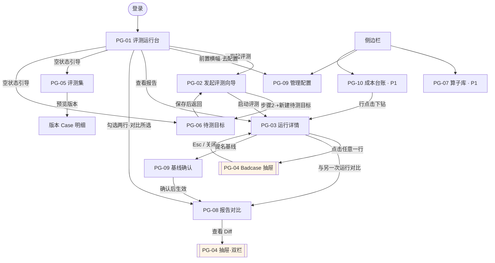
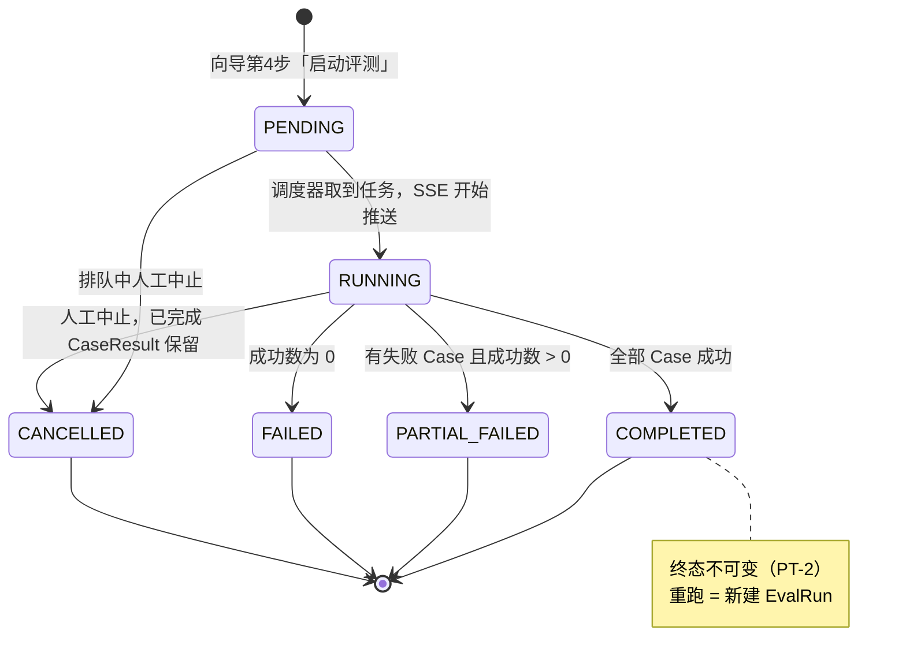

# 页面与流程

> **本文件是「页面结构 / 按钮文案 / 状态流转 / 跳转关系」的唯一事实源。**
> 角色见 [`product-overview.md`](./product-overview.md)（`ROLE-A` / `ROLE-B`）；
> 故事与优先级见 [`user-stories.md`](./user-stories.md)（`US-001`…`US-021`）。
> 规则依据：`docs/工程规则.md` 第 1 节「单一事实源原则」。
>
> 建立日期：2026-11-07
> 状态：**已确认**（需求方 2026-11-07 拍板 Q1–Q4）

---

## 0. 编号与约束

### 0.1 编号体系

- 页面编号使用 **`PG-01` … `PG-10`**。
- **不使用 `P1`–`P6` 作为页面编号**：`P0/P1/P2` 已被优先级占用，混用会在 SPEC 与代码中产生永久歧义。
- 状态编号使用 **`RS-*`**（Run Status）。

### 0.2 两条设计准则（已确认）

| 编号 | 准则 |
|---|---|
| PF-1 | **可追溯**：每个页面、每个区块、每个核心按钮都必须能追溯到 `US-xxx`。严禁无故事支撑的页面与文案。 |
| PF-2 | **克制**：`P2` 故事不单独建页面；无故事支撑的界面元素一律不做，列入 §7 拒绝清单。 |

### 0.3 导航结构（只允许 4 个分区）

```
运行    PG-01 评测运行台 · PG-02 发起评测向导 · PG-03 评测运行详情 · PG-08 报告对比(P1)
资产    PG-05 评测集 · PG-06 待测目标
算子    PG-07 算子库(P1)
管理    PG-09 管理配置 · PG-10 成本台账(P1)
```

**不设首页大屏、不设欢迎页。** 登录后直接进入 `PG-01`。

---

## 1. 页面矩阵

### PG-01 · 评测运行台（Runs）

| 项 | 内容 |
|---|---|
| 用途 | 查看历史跑批、判断哪次值得深挖、发起新评测 |
| 优先级 | P0 |

**页面区域**

| 区域 | 内容 |
|---|---|
| 1 · 标题栏 | 标题「评测运行」；主按钮 **「+ 发起评测」** |
| 2 · 前置依赖横幅 | 条件显示（未配置模型网关凭证时）：**「尚未配置模型网关凭证，无法发起评测。［去配置］」** |
| 3 · 运行列表 | 列：`评测名称 ｜ 状态 ｜ 综合得分 ｜ 耗时 ｜ Token 成本 ｜ 发起人 ｜ 发起时间 ｜ 操作` |

**按钮与微文案**

| 按钮 | 文案 | 显示条件 | 优先级 |
|---|---|---|---|
| 主按钮 | **+ 发起评测** | 始终 | P0 · `US-006` |
| 行内 | **查看报告** | 始终 | P0 · `US-008` |
| 行内 | **中止** | 仅 `RUNNING` / `PENDING` | P1 · `US-014` |
| 行内 | **提名基线** | 仅 `COMPLETED` / `PARTIAL_FAILED` | P1 · `US-013` |
| 批量 | **对比所选（2）** | 勾选恰好 2 行时 | P1 · `US-009` |

**空状态**

> 「还没有评测记录。」
> 引导链接：`去导入评测集` → `PG-05`；`去创建待测目标` → `PG-06`

**支撑故事**：`US-006`(P0) `US-008`(P0) `US-007`(P0·入口) `US-015`(P0·横幅) `US-014`(P1) `US-013`(P1) `US-009`(P1)

---

### PG-02 · 发起评测向导（New Run）

| 项 | 内容 |
|---|---|
| 用途 | 把「评测集版本 × 待测目标 × 算子组合」一次配好并启动 |
| 优先级 | P0 |
| 形态 | **独立整页 4 步向导**（不用弹窗：选择 + 参数配置，弹窗装不下） |

**步骤**

| 步骤 | 标题 | 内容 |
|---|---|---|
| 1 | **选择评测集版本** | 评测集下拉 → 版本列表（`version_no`、条目数、创建时间、`content_hash` 前 8 位） |
| 2 | **选择待测目标** | Target 列表（模型 + Prompt 模板摘要）；**「+ 新建待测目标」** → `PG-06` |
| 3 | **配置评测算子** | 两区块：**「确定性规则算子」** / **「LLM 裁判算子」**；各含 **「+ 添加算子」**；参数内联可填（K 值、JSON Schema、数值容差、裁判模型、评分 Prompt、通过阈值） |
| 4 | **确认并发与运行** | 并发数输入 + 配置摘要 + 主按钮 **「启动评测」** |

**按钮微文案**：底部固定 **「上一步」/「下一步」/「启动评测」/「取消」**；取消二次确认 **「放弃本次配置？」**

**阻塞校验（防脏跑批）**

| 条件 | 提示文案 |
|---|---|
| 选了 `Recall@K`/`MRR`/`nDCG@K` 但所选版本无 `retrieval.relevant` | **「当前数据集版本没有检索标注，无法计算 Recall@K。请更换版本或移除该算子。」** |
| 未配置任何算子 | **「请至少配置一个评测算子。」** |
| 未配置模型网关凭证 | **「尚未配置模型网关凭证，无法发起评测。」** |

**支撑故事**：`US-006`(P0·主体) `US-003`(P0) `US-004`(P0) `US-005`(P0·选择与新建入口)

---

### PG-03 · 评测运行详情（Run Detail）

| 项 | 内容 |
|---|---|
| 用途 | 实时看进度、看汇总结论、逐条下钻 |
| 优先级 | P0 |

**页面区域**

| 区域 | 内容 |
|---|---|
| 1 · 元数据栏 | 名称、状态徽章、评测集@版本、Target@版本、算子数、发起人、开始 / 结束时间 |
| 2 · 汇总指标卡 | 综合得分、通过率、耗时 P50 / P95、Token 总量、成本（分列「待测成本」/「裁判成本」，口径受 `OPEN-3` 约束） |
| 3 · 运行中条 | **「已完成 128 / 300，失败 2」** + 进度条 + 「实时更新中」指示（`US-007`） |
| 4 · 工具栏 | P0：仅「按得分升序 / 降序」；P1 增：得分区间、算子、失败状态、是否退化 |
| 5 · 明细表 | 列：`Case Key ｜ Query 摘要 ｜ 得分 ｜ 各算子得分 ｜ 耗时 ｜ Token ｜ 状态 ｜ 操作`；行尾 **「查看」**，整行可点 |

**按钮与微文案**

| 按钮 | 文案 | 显示条件 | 优先级 |
|---|---|---|---|
| — | **中止评测** | `RUNNING` / `PENDING` | P1 · `US-014` |
| — | **提名基线** | `COMPLETED` / `PARTIAL_FAILED` | P1 · `US-013` |
| — | **与另一次运行对比** | 终态 | P1 · `US-009` |

**中止确认文案**：**「已完成的 N 条结果会保留，确定中止？」**

**可复现性说明文案（`OPEN-4` 🔒 锁死，不可改写）**

> 元数据栏固定展示：**「EvalRun 可解释，不可复现。」**
>
> 悬停/点击展开详情（`reproducibility`）：`temperature` / `top_p` / `max_tokens` / `seed` /
> `runner_version` / `model_version_string` / `prompt_template_hash`，并标注
> `cache_policy: none`。
>
> 依据见 `technical-solution.md` §2 `OPEN-4`。**此句不得被改写成「可复现」「结果稳定」
> 等同义表述** —— 首版不做响应缓存，宣称可复现即是对外撒谎。

**支撑故事**：`US-007`(P0) `US-008`(P0) `US-011`(P0·入口) `US-010`(P1) `US-014`(P1) `US-013`(P1)

---

### PG-04 · Badcase 诊断抽屉（Case Inspector Drawer）

| 项 | 内容 |
|---|---|
| 用途 | 单条 Case 全貌同屏诊断 |
| 优先级 | P0（单栏）/ P1（双栏 Diff） |
| 形态 | **右侧宽抽屉（Overlay，非独立页面）**；不提供直达 URL，刷新后回到 `PG-03` |

**区块**

| 区块 | 内容 |
|---|---|
| 1 · 输入 | Query + 全部输入变量 |
| 2 · 标准参考答案 | `golden_answer`；缺失时显示 **「本条未提供参考答案」** |
| 3 · 输出 | **P0**：单栏（当前输出）；**P1**：双栏（基线 vs 当前），差异高亮 |
| 4 · 检索上下文 | Context 切片列表（`doc_id` + 片段） |
| 5 · 打分明细 | 每个算子的得分、阈值、是否通过；裁判算子附扣分理由 |

**按钮**：仅 **「关闭」**（`Esc` 亦可）。

**明确不做**：无「人工改判」、无「提交修正」、无「加入回流」（`US-012` 为 P2，且属 `OUT-1` 范畴）。

**降级规则**：无已确认 baseline 时，区块 3 单栏展示并标注 **「暂无基线，仅显示本次输出」**。

**支撑故事**：`US-011`(P0) `US-002`(P0·参考答案) `US-009`(P1·双栏数据来源)

---

### PG-05 · 评测集（Datasets）

| 项 | 内容 |
|---|---|
| 用途 | 管理评测集、上传校验、生成不可变版本快照、预览明细 |
| 优先级 | P0 |

**页面区域**

| 区域 | 内容 |
|---|---|
| 1 · 标题栏 | 「评测集」；主按钮 **「+ 导入评测集」** |
| 2 · 列表 | 列：`名称 ｜ 最新版本 ｜ 条目数 ｜ 来源 ｜ 最近更新 ｜ 操作`；行操作 **「查看版本」** |
| 3 · 上传面板 | 文件（JSONL / CSV）+ 名称 + 校验结果区（`通过 298 条 / 失败 2 条`，失败逐行列出，如 `第 47 行：缺少 case_key 且 input 为空`）→ 主按钮 **「生成新版本」** |
| 4 · 版本历史 | `version_no`、条目数、`content_hash`、创建人、时间；**「预览」** 展开 Case 明细表 |

**不可变提示（版本详情顶部固定文案）**

> **「版本 v3 已发布，不可修改。如需调整数据，请导入并生成新版本。」**

**明确不做**：无「删除版本」（违反 `PT-2`）；无「导出 JSONL」（无故事支撑）。

**支撑故事**：`US-001`(P0) `US-002`(P0)

---

### PG-06 · 待测目标（Targets）

| 项 | 内容 |
|---|---|
| 用途 | 创建与维护待测目标，自动带版本 |
| 优先级 | P0（T1）/ P1（T2 字段） |

**页面区域**

| 区域 | 内容 |
|---|---|
| 1 · 标题栏 | 「待测目标」；主按钮 **「+ 新建目标」** |
| 2 · 列表 | 列：`名称 ｜ 类型 ｜ 模型 ｜ 当前版本 ｜ 更新时间 ｜ 操作`；**「查看版本」** |
| 3 · 表单（P0 · T1） | 名称、类型（**T2 选项置灰，标注「P1 支持」**）、模型、Prompt 模板（变量 `{{input}}`）、temperature、max_tokens |
| 4 · P1 扩展（T2） | URL、鉴权 Header、请求 / 响应字段映射（`US-021`） |

**版本语义文案**

> **「保存后将生成 v2，历史运行仍引用 v1」**

**支撑故事**：`US-005`(P0) `US-021`(P1)

---

### PG-07 · 算子库（Evaluators）

| 项 | 内容 |
|---|---|
| 用途 | 全局算子模板管理 |
| 优先级 | **P1（P0 期此页面不存在）** |

> P0 期 `US-003` / `US-004` 的能力全部**内联在 `PG-02` 第 3 步**，不建独立页面。

**页面区域**

| 区域 | 内容 |
|---|---|
| Tabs | **「确定性规则算子」** / **「LLM 裁判模板」** |
| 内容 | 内置算子只读清单（Recall@K / MRR / nDCG@K / JSON Schema / 正则 / 数值保真）+ 自定义裁判模板 CRUD |
| 按钮 | **「+ 新建裁判模板」**（名称、裁判模型、评分 Prompt、分值区间、通过阈值）；**「另存为模板」**（从运行内配置提炼） |

**支撑故事**：`US-016`(P1)

---

### PG-08 · 报告对比（Compare）

| 项 | 内容 |
|---|---|
| 用途 | 两次 EvalRun 的汇总与逐条对比 |
| 优先级 | P1 |

**页面区域**

| 区域 | 内容 |
|---|---|
| 1 · 选择器 | 「基线」/「当前」两个运行选择器 + **「开始对比」** |
| 2 · 汇总对比表 | `指标 ｜ 基线 ｜ 当前 ｜ 变化`（↑↓ 着色 + 百分比） |
| 3 · 逐条对比表 | `case_key ｜ 基线得分 ｜ 当前得分 ｜ 变化 ｜ 操作「查看 Diff」` → 打开 `PG-04` 双栏 |

**约束横幅**：未确认 baseline 时显示 **「尚未确认基线，本次对比仅供观察，不作为门禁依据」**。

**支撑故事**：`US-009`(P1) `US-010`(P1) `US-011`(P1·双栏) `US-020`(P1)

---

### PG-09 · 管理配置（Admin）

| 项 | 内容 |
|---|---|
| 优先级 | P0（模型网关 Tab）/ P1（其余 Tab） |
| 可见性 | 仅 `ROLE-B` 可见 |

| Tab | 内容 | 优先级 | 故事 |
|---|---|---|---|
| **模型网关** | 厂商、API Key（回显 `sk-••••3f2a`，仅可覆盖不可读）、输入 / 输出千 Token 单价、并发上限；**「保存」** | P0 | `US-015` |
| **门禁规则** | 规则名、评测集 + Target、阈值条件、阻断动作；**「保存规则」** | P1 | `US-017` |
| **基线确认** | 待确认提名列表（运行名 / 提名理由 / 提名时间）；**「确认」/「驳回」** | P1 | `US-020` `US-013` |
| **推送渠道** | 飞书 / 企微 Webhook URL；生成回调 Token | P1 | `US-018` |

**GitHub 推送的实现边界（已确认）**：平台**只输出结构化 JSON 门禁结果**，由 CI 侧（GitHub Actions）读取并写 PR 评论。平台侧**永不持有、永不输入任何 GitHub PAT**。因此本 Tab **不出现任何 GitHub 凭据输入框**。规则依据：`docs/工程规则.md` §9。

---

### PG-10 · 成本台账（Cost Ledger）

| 项 | 内容 |
|---|---|
| 优先级 | P1 |

**页面区域**

| 区域 | 内容 |
|---|---|
| 1 · 筛选 | 时间范围 + 维度切换（模型 / 评测集 / 发起人） |
| 2 · 汇总卡 | 总 Token、总费用、调用次数 |
| 3 · 明细表 | 行点击下钻 `PG-03` |

**支撑故事**：`US-019`(P1)

---

## 2. 页面 ↔ 故事 覆盖矩阵

> 用于核对是否存在「无故事页面」或「无落点故事」。**P0 / P1 故事必须全部有落点。**

| 故事 | 优先级 | 落点页面 | 覆盖状态 |
|---|---|---|---|
| US-001 导入与版本快照 | P0 | PG-05 | ✅ |
| US-002 浏览版本 / Case 明细 | P0 | PG-05、PG-04 | ✅ |
| US-003 规则算子配置 | P0 | PG-02(步骤3) | ✅ |
| US-004 裁判算子配置 | P0 | PG-02(步骤3) | ✅ |
| US-005 创建 Target(T1) | P0 | PG-06、PG-02(步骤2) | ✅ |
| US-006 发起 EvalRun | P0 | PG-02、PG-01 | ✅ |
| US-007 SSE 进度 | P0 | PG-03(区域3) | ✅ |
| US-008 单次运行报告 | P0 | PG-03(区域2)、PG-01 | ✅ |
| US-011 Badcase Diff | P0 | PG-04 | ✅ |
| US-015 网关凭证 | P0 | PG-09(模型网关 Tab)、PG-01(横幅) | ✅ |
| US-009 双版本对比 | P1 | PG-08、PG-04(双栏) | ✅ |
| US-010 Badcase 筛选 | P1 | PG-03(区域4)、PG-08 | ✅ |
| US-013 提名 Baseline | P1 | PG-01、PG-03 | ✅ |
| US-014 中止 EvalRun | P1 | PG-01、PG-03 | ✅ |
| US-016 算子模板 | P1 | PG-07 | ✅ |
| US-017 门禁规则 | P1 | PG-09(门禁规则 Tab) | ✅ |
| US-018 门禁推送 | P1 | PG-09(推送渠道 Tab) | ✅ |
| US-019 Token 台账 | P1 | PG-10 | ✅ |
| US-020 确认 Baseline | P1 | PG-09(基线确认 Tab)、PG-08 | ✅ |
| US-021 接入 T2 | P1 | PG-06(区域4) | ✅ |
| US-012 一键回流 | P2 | **不建页面**（P2 准则） | ⛔ 按设计 |

**结论**：20 条 P0/P1 故事**全部有页面落点**；唯一 P2 故事按 `PF-2` 不建页面。

---

## 3. 页面导航与跳转流



---

## 4. EvalRun 状态机

### 4.1 状态定义（`RS-*`）

| 编号 | 状态 | 徽章文案 | 语义 |
|---|---|---|---|
| RS-01 | `PENDING` | 待执行 | 已创建，尚未被调度器取到 |
| RS-02 | `RUNNING` | 运行中 | 并发跑批中，SSE 实时推送 |
| RS-03 | `COMPLETED` | 已完成 | **全部** Case 成功 |
| RS-04 | `PARTIAL_FAILED` | 部分失败 | 有失败 Case，但**成功数 > 0** |
| RS-05 | `FAILED` | 失败 | **成功数为 0**（配置错误 / 额度耗尽 / 端点不可达） |
| RS-06 | `CANCELLED` | 已中止 | 人工中止，已产生的 CaseResult 保留 |

> **`FAILED` 与 `PARTIAL_FAILED` 必须区分**（已确认）：全部失败通常是配置错误，运维后果与「跑通了但有瑕疵」完全不同，界面颜色与文案必须分开。

### 4.2 状态流转



### 4.3 按钮可用性矩阵

| 状态 | 徽章文案 | 「中止」 | 「查看报告」 | 「提名基线」 | 「对比」 |
|---|---|---|---|---|---|
| `PENDING` | 待执行（灰） | P1 · 可用 | 可用（空表格） | 不可用 | 不可用 |
| `RUNNING` | 运行中（蓝 · 脉冲） | P1 · 可用 | 可用（实时刷新） | 不可用 | 不可用 |
| `COMPLETED` | 已完成（绿） | 隐藏 | 可用 | P1 · 可用 | P1 · 可用 |
| `PARTIAL_FAILED` | 部分失败（橙） | 隐藏 | 可用 | P1 · 可用 | P1 · 可用 |
| `FAILED` | 失败（红） | 隐藏 | 可用 | 不可用 | P1 · 可用 |
| `CANCELLED` | 已中止（灰） | 隐藏 | 可用（含不完整标记） | 不可用 | P1 · 可用 |

---

## 5. 空状态与异常态文案

| 场景 | 文案 |
|---|---|
| `PG-01` 无运行记录 | 「还没有评测记录。」+ `去导入评测集` / `去创建待测目标` |
| `PG-01` 未配凭证横幅 | 「尚未配置模型网关凭证，无法发起评测。［去配置］」 |
| `PG-02` 无检索标注 | 「当前数据集版本没有检索标注，无法计算 Recall@K。请更换版本或移除该算子。」 |
| `PG-02` 无算子 | 「请至少配置一个评测算子。」 |
| `PG-05` 上传零通过 | 「没有可导入的有效记录，请检查文件格式。」 |
| `PG-04` 无参考答案 | 「本条未提供参考答案」 |
| `PG-04` 无基线 | 「暂无基线，仅显示本次输出」 |
| `PG-08` 未确认基线 | 「尚未确认基线，本次对比仅供观察，不作为门禁依据」 |
| `PG-03` 中止确认 | 「已完成的 N 条结果会保留，确定中止？」 |
| `PG-02` 取消确认 | 「放弃本次配置？」 |

---

## 6. 全局视觉与交互约束

- 颜色**必须**走 Tailwind Token / CSS 变量，禁止裸写 `#hex`（`docs/工程规则.md` §4）。
- 状态徽章配色：灰（待执行）/ 蓝（运行中）/ 绿（已完成）/ 橙（部分失败）/ 红（失败）/ 灰（已中止）。
- `PG-04` 抽屉不提供直达 URL；`PG-03` 支持直达 URL（运行 ID）。
- 具体视觉规范见后续 `docs/facts/DESIGN.md`（基于 shadcn/ui + Tailwind CSS Variables）。

---

## 7. 明确拒绝的界面元素（已确认）

> 用于防止后续反复讨论与界面膨胀。

| 拒绝项 | 理由 |
|---|---|
| 首页大屏 / 欢迎页 | 无故事支撑，只有口号 |
| 全局搜索 | 无故事支撑；`PG-01` / `PG-05` 自带筛选 |
| 站内消息中心 | `US-018` 是**外推**到飞书 / 企微 / PR，不做站内收件箱 |
| 用户 / 团队 / 角色管理页 | `OUT-4`：只留 `owner_id` / `workspace_id` 字段，不做功能 |
| 运行前「预估 Token 消耗」 | 无故事支撑；风险由 `US-015` 并发上限约束 |
| 单条 Case 重跑 / 人工改判 | 无故事支撑，且属人工评测体系 |
| 定时 / 周期评测 | 无故事支撑 |
| 导出 PDF / 分享链接 | 无故事支撑 |
| 删除评测集版本 | 违反 `PT-2` 不可变红线 |
| `PG-07` 算子库的 P0 版本 | P0 期算子配置内联于 `PG-02`，独立页面无故事消费方 |

---

## 8. 变更记录

| 日期 | 变更 | 说明 |
|---|---|---|
| 2026-11-07 | 建立本文件 | 页面矩阵 `PG-01`…`PG-10`、两张 Mermaid 图、按钮矩阵、拒绝清单；Q1–Q4 已拍板 |
| 2026-11-07 | 补 `OPEN-4` 锁死句落点 | `technical-solution.md` §2 要求「EvalRun 可解释，不可复现。」原样出现在三处，本文件 PG-03 原缺失，已补入「可复现性说明文案」小节 |
